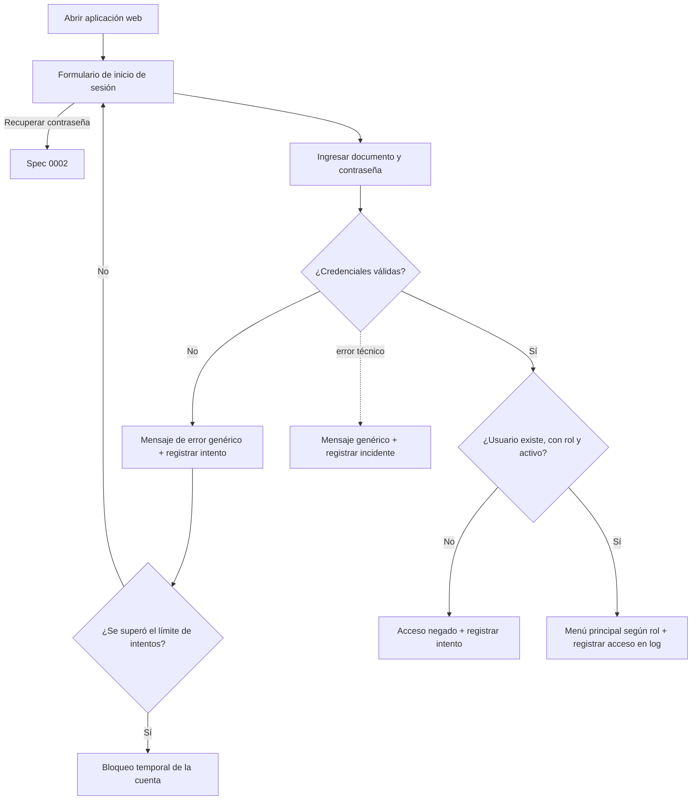

# Spec 0001: Inicio de sesión

| Campo | Valor |
| --- | --- |
| ID | SPEC-0001 |
| Épica | EP-01 Gestión de usuarios y acceso |
| Historias de usuario | HU-01 Iniciar sesión (talla M, 26,00 h) |
| Caso de uso | CU.0001 Inicio de Sesión |
| Actores | Administrador, coordinador, docente, estudiante y acudiente |
| Prioridad | HU: Alta [A3] · CU: MUY IMPORTANTE / URGENTE [A2] |
| Componente | Seguridad y acceso (EP-01) |
| ADR relacionados | [ADR-0001](../02-adrs/0001-aplicacion-web-con-portales-por-rol.md), [ADR-0004](../02-adrs/0004-api-gateway-rest-https-punto-unico-de-entrada.md), [ADR-0005](../02-adrs/0005-autenticacion-jwt-y-autorizacion-por-roles.md) |
| Mockup | [0001-inicio-de-sesion.html](../04-mockups/0001-inicio-de-sesion.html) |
| Estado | En revisión |

## 1. Resumen y objetivo

Permitir que un usuario se autentique mediante un formulario web con su documento de identidad y contraseña, para acceder al menú de opciones permitidas según su rol [A2][A3].

## 2. Alcance

**Dentro**
- Formulario de inicio de sesión con usuario (documento de identidad) y contraseña.
- Validación de credenciales, rol y estado del usuario.
- Redirección al menú principal según el rol.
- Registro de accesos e intentos fallidos en el log.
- Bloqueo temporal por exceso de intentos.
- Acceso a la opción «Recuperar contraseña» (el flujo se especifica en [Spec 0002](0002-recuperar-contrasena.md)).

**Fuera**
- Creación de usuarios y asignación de roles ([Spec 0003](0003-administrar-usuarios-roles-y-permisos.md)).
- Cierre de sesión y expiración de sesión: **No documentado**.

## 3. Requisitos

### 3.1. Requisitos funcionales

| ID | Requisito | Fuente |
| --- | --- | --- |
| RF-0001-01 | El sistema debe mostrar un formulario web de inicio de sesión con los campos usuario y contraseña. | [A2] CU.0001 pasos 1–2 |
| RF-0001-02 | El sistema debe usar como usuario el documento de identidad (cédula o tarjeta de identidad). | [A2] CU.0001 restricciones; [A3] HU-01 CA-1 |
| RF-0001-03 | El sistema debe mostrar la contraseña enmascarada. | [A2] CU.0001 restricciones |
| RF-0001-04 | El sistema debe verificar el usuario y la contraseña ingresados. | [A2] CU.0001 paso 5 |
| RF-0001-05 | El sistema debe validar que el usuario exista, tenga un rol asociado y esté activo. | [A2] CU.0001 precondición y paso 6; [A3] HU-01 CA-2 |
| RF-0001-06 | Al autenticarse correctamente, el sistema debe llevar al usuario al menú principal con las opciones permitidas según su rol. | [A2] CU.0001 paso 7; [A3] HU-01 CA-3 |
| RF-0001-07 | El sistema debe registrar en el log de acceso cada acceso exitoso. | [A2] CU.0001 postcondición y paso 7; [A3] HU-01 CA-6 |
| RF-0001-08 | El sistema debe registrar los intentos fallidos. | [A2] CU.0001 error 2; [A3] HU-01 CA-6 |
| RF-0001-09 | El sistema debe ofrecer en el formulario la opción de recuperar contraseña. | [A2] CU.0001 restricciones; [A3] HU-01 CA-5 |
| RF-0001-10 | El sistema debe bloquear temporalmente la cuenta cuando se supere el número de intentos permitidos. | [A2] CU.0001 error 3 |

### 3.2. Reglas de negocio

| ID | Regla | Fuente |
| --- | --- | --- |
| RN-0001-01 | Solo pueden autenticarse usuarios creados previamente, asociados a un rol y en estado activo. | [A2] CU.0001 precondición |
| RN-0001-02 | Roles del sistema: administrador, coordinador, docente, estudiante y acudiente. | [A2] |
| RN-0001-03 | La contraseña debe contener letras, números y un signo. | [A2] CU.0001 restricciones |
| RN-0001-04 | Ante credenciales incorrectas, el mensaje no indica cuál dato falló. | [A2] CU.0001 error 1; [A3] HU-01 CA-4 |
| RN-0001-05 | El acceso está sujeto a restricción por IP pública. | [A2] CU.0001 restricciones |

### 3.3. Requisitos no funcionales

| ID | Categoría | Requisito y métrica | Fuente |
| --- | --- | --- | --- |
| RNF-0001-01 | Disponibilidad / Portabilidad | Acceso web desde un navegador. Navegadores soportados: **No documentado**. | [A2] |
| RNF-0001-02 | Seguridad | La contraseña no se muestra en claro durante la escritura. | [A2] |
| RNF-0001-03 | Seguridad | Comunicación por HTTPS y validación de token de sesión en el punto de entrada. | [A4]; [ADR-0004](../02-adrs/0004-api-gateway-rest-https-punto-unico-de-entrada.md) |
| RNF-0001-04 | Seguridad | Los errores técnicos se muestran con un mensaje genérico y se registran en el log. | [A2] CU.0001 error 4 |
| RNF-0001-05 | Rendimiento | Tiempo de respuesta del inicio de sesión: **No documentado**. | — |

## 4. Datos y contratos

| Entidad (según fuentes) | Atributos mencionados | Fuente |
| --- | --- | --- |
| Usuario | Documento de identidad (usuario), contraseña, rol, estado (activo/inactivo), correo registrado | [A2] CU.0001 |
| Log de acceso | Evento de acceso, intento fallido, incidente técnico | [A2] CU.0001 |

- Contrato de API del inicio de sesión (endpoint, formato de petición/respuesta): **No documentado**.
- Token de sesión: JWT [A4]. Estructura y duración: **No documentado**.

## 5. Flujos y estados



Estados de la pantalla: formulario vacío · validando · error de credenciales · acceso negado · cuenta bloqueada temporalmente · error técnico · autenticado.

## 6. Casos borde y errores

| Caso | Comportamiento esperado | Fuente |
| --- | --- | --- |
| Usuario o contraseña incorrectos | Mensaje de error sin indicar qué dato falló. | [A2] error 1 |
| Usuario inexistente o inactivo | Acceso negado y registro del intento. | [A2] error 2 |
| Exceso de intentos | Bloqueo temporal de la cuenta. | [A2] error 3 |
| Error técnico | Mensaje genérico y registro del incidente en el log. | [A2] error 4 |
| Acceso desde una IP no permitida | **Información insuficiente**: la regla de IP no está definida. | [A2] |

## 7. Criterios de aceptación

```gherkin
Escenario: Inicio de sesión exitoso
  Dado un usuario creado, asociado a un rol y en estado activo
  Cuando ingresa su documento de identidad y su contraseña correctos y da clic en "Iniciar sesión"
  Entonces el sistema lo lleva al menú principal con las opciones permitidas para su rol
  Y registra el acceso en el log de acceso

Escenario: Credenciales incorrectas
  Dado un usuario en el formulario de inicio de sesión
  Cuando ingresa un usuario o una contraseña incorrectos
  Entonces el sistema muestra un mensaje de error que no indica cuál de los dos datos falló
  Y registra el intento fallido

Escenario: Usuario inactivo
  Dado un usuario en estado inactivo
  Cuando intenta iniciar sesión con credenciales correctas
  Entonces el sistema niega el acceso
  Y registra el intento

Escenario: Bloqueo temporal por intentos
  Dado un usuario que ha superado el número de intentos fallidos permitidos
  Cuando intenta iniciar sesión de nuevo
  Entonces el sistema mantiene la cuenta bloqueada temporalmente

Escenario: Contraseña enmascarada
  Dado el formulario de inicio de sesión
  Cuando el usuario escribe su contraseña
  Entonces los caracteres no se muestran en claro

Escenario: Error técnico
  Dado que ocurre un error técnico durante la autenticación
  Cuando el usuario da clic en "Iniciar sesión"
  Entonces el sistema muestra un mensaje genérico
  Y registra el incidente en el log
```

Criterios pendientes de definición: número máximo de intentos y duración del bloqueo (ver P-0001-01).

## 8. Riesgos y pendientes

| ID | Tipo | Descripción |
| --- | --- | --- |
| P-0001-01 | No documentado | Número de intentos fallidos permitidos y duración del bloqueo temporal. |
| P-0001-02 | Información insuficiente | Alcance de la «restricción por IP pública»: a qué roles se aplica y cómo afecta a estudiantes y acudientes que consultan desde fuera de la institución. |
| P-0001-03 | No documentado | Opciones del menú principal por rol. [VIS] solo muestra el menú del docente y del estudiante (Inicio, Grupos, Calificaciones, Reportes). |
| P-0001-04 | No documentado | Longitud mínima de la contraseña y la definición de «signo». |
| P-0001-05 | No documentado | Cierre de sesión y expiración de sesión. |
