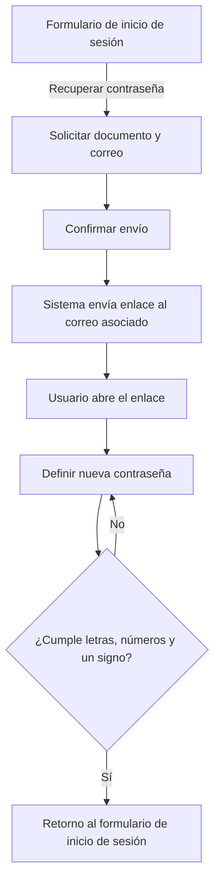

# Spec 0002: Recuperar contraseña

| Campo | Valor |
| --- | --- |
| ID | SPEC-0002 |
| Épica | EP-01 Gestión de usuarios y acceso |
| Historias de usuario | HU-04 Recuperar contraseña (talla S, 13,08 h); HU-01 CA-5 |
| Caso de uso | CU.0001 Inicio de Sesión — secuencia alternativa |
| Actores | Administrador, coordinador, docente, estudiante y acudiente |
| Prioridad | **No documentado** para HU-04 (la prioridad solo figura para HU-01, HU-02 y HU-03) |
| Componente | Seguridad y acceso (EP-01); Correo transaccional (SaaS) |
| ADR relacionados | [ADR-0005](../02-adrs/0005-autenticacion-jwt-y-autorizacion-por-roles.md), [ADR-0009](../02-adrs/0009-correo-transaccional-saas.md) |
| Mockup | [0002-recuperar-contrasena.html](../04-mockups/0002-recuperar-contrasena.html) |
| Estado | En revisión |

## 1. Resumen y objetivo

Permitir que un usuario que no recuerda su contraseña defina una nueva mediante un enlace de restablecimiento enviado al correo registrado [A2][A3].

## 2. Alcance

**Dentro**
- Solicitud de recuperación con documento de identidad y correo registrado.
- Envío del enlace de restablecimiento al correo asociado.
- Definición de una nueva contraseña que cumpla las restricciones y regreso al formulario de inicio de sesión.

**Fuera**
- Cambio de contraseña desde una sesión activa: **No documentado**.
- Restablecimiento de contraseña por un administrador: **No documentado**.

## 3. Requisitos

### 3.1. Requisitos funcionales

| ID | Requisito | Fuente |
| --- | --- | --- |
| RF-0002-01 | El sistema debe permitir seleccionar la opción «Recuperar contraseña» desde el formulario de inicio de sesión. | [A2] CU.0001 alt. 1 |
| RF-0002-02 | El sistema debe solicitar el documento de identidad y el correo registrado. | [A2] CU.0001 alt. 2 |
| RF-0002-03 | El usuario debe ingresar los datos y confirmar el envío. | [A2] CU.0001 alt. 3 |
| RF-0002-04 | El sistema debe enviar un enlace de restablecimiento al correo asociado. | [A2] CU.0001 alt. 4; [A3] HU-01 CA-5 |
| RF-0002-05 | El sistema debe permitir definir una nueva contraseña que cumpla las restricciones. | [A2] CU.0001 alt. 5 |
| RF-0002-06 | Tras definir la nueva contraseña, el sistema debe retornar al formulario de inicio de sesión. | [A2] CU.0001 alt. 5 |

### 3.2. Reglas de negocio

| ID | Regla | Fuente |
| --- | --- | --- |
| RN-0002-01 | La nueva contraseña debe contener letras, números y un signo. | [A2] CU.0001 restricciones |
| RN-0002-02 | El enlace se envía al correo asociado al usuario. | [A2] CU.0001 alt. 4 |

### 3.3. Requisitos no funcionales

| ID | Categoría | Requisito y métrica | Fuente |
| --- | --- | --- | --- |
| RNF-0002-01 | Integración | El envío se realiza mediante el servicio de correo transaccional SaaS. | [A3][A4]; [ADR-0009](../02-adrs/0009-correo-transaccional-saas.md) |
| RNF-0002-02 | Seguridad | Vigencia del enlace: **No documentado**. | — |

## 4. Datos y contratos

| Entidad | Atributos mencionados | Fuente |
| --- | --- | --- |
| Usuario | Documento de identidad, correo registrado, contraseña | [A2] |
| Enlace de restablecimiento | **No documentado** (vigencia, uso único). | — |

Contrato de API: **No documentado**.

## 5. Flujos y estados



Estados: solicitud · enlace enviado · definición de contraseña · contraseña inválida · contraseña actualizada.

## 6. Casos borde y errores

| Caso | Comportamiento esperado | Fuente |
| --- | --- | --- |
| La nueva contraseña no cumple las restricciones | No se acepta; el usuario debe definir una que las cumpla. | [A2] alt. 5 (implícito en «que cumple las restricciones») |
| El documento y el correo no corresponden a un usuario | **No documentado**. | — |
| Enlace vencido o ya utilizado | **No documentado**. | — |
| Fallo del servicio de correo | **No documentado**. | — |

## 7. Criterios de aceptación

```gherkin
Escenario: Solicitud de recuperación
  Dado un usuario en el formulario de inicio de sesión
  Cuando selecciona "Recuperar contraseña"
  Entonces el sistema solicita el documento de identidad y el correo registrado

Escenario: Envío del enlace
  Dado un usuario que ingresó su documento de identidad y su correo registrado
  Cuando confirma el envío
  Entonces el sistema envía un enlace de restablecimiento al correo asociado

Escenario: Nueva contraseña válida
  Dado un usuario que abrió el enlace de restablecimiento
  Cuando define una contraseña con letras, números y un signo
  Entonces el sistema la acepta
  Y retorna al formulario de inicio de sesión

Escenario: Nueva contraseña inválida
  Dado un usuario que abrió el enlace de restablecimiento
  Cuando define una contraseña sin letras, sin números o sin signo
  Entonces el sistema no la acepta
```

Pendientes de definición: respuesta ante datos que no coinciden, vigencia del enlace y fallo del correo (P-0002-01 a P-0002-03).

## 8. Riesgos y pendientes

| ID | Tipo | Descripción |
| --- | --- | --- |
| P-0002-01 | No documentado | Mensaje cuando el documento y el correo no coinciden con un usuario (y si debe ser genérico, como en el inicio de sesión). |
| P-0002-02 | No documentado | Vigencia y uso único del enlace. |
| P-0002-03 | No documentado | Comportamiento si el servicio de correo falla. |
| P-0002-04 | No documentado | Si la recuperación debe registrarse en el log de acceso. |
| P-0002-05 | No documentado | Prioridad de HU-04. |
