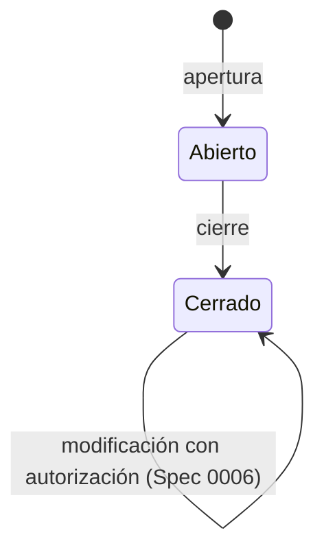

# Spec 0005: Configurar periodos académicos

| Campo | Valor |
| --- | --- |
| ID | SPEC-0005 |
| Épica | EP-02 Gestión académica |
| Historias de usuario | HU-08 Configurar periodos académicos (talla S, 13,08 h) |
| Caso de uso | No hay caso de uso detallado |
| Actores | Coordinador / administrador (según «Portal Coordinación / Admin.» [A4]) |
| Prioridad | **No documentado** |
| Componente | Gestión académica (EP-02) |
| ADR relacionados | [ADR-0006](../02-adrs/0006-backend-modular-alineado-a-epicas.md) |
| Mockup | No definido: las fuentes no describen pantallas para esta funcionalidad |
| Estado | Borrador — información insuficiente |

## 1. Resumen y objetivo

Configurar los periodos académicos y gestionar su apertura y cierre, que determinan si los docentes pueden registrar o modificar notas [A2][A3][A4].

## 2. Alcance

**Dentro**
- Configuración de periodos académicos [A3 HU-08].
- Apertura y cierre de periodos [A4 componente EP-02].

**Fuera**
- Autorización de modificaciones en periodos cerrados: se especifica en [Spec 0006](0006-registrar-y-modificar-calificaciones.md).

## 3. Requisitos

### 3.1. Requisitos funcionales

| ID | Requisito | Fuente |
| --- | --- | --- |
| RF-0005-01 | El sistema debe permitir configurar periodos académicos. | [A3] HU-08 |
| RF-0005-02 | El sistema debe permitir abrir y cerrar periodos académicos. | [A4] componente EP-02 |

### 3.2. Reglas de negocio

| ID | Regla | Fuente |
| --- | --- | --- |
| RN-0005-01 | Un periodo tiene estado **abierto** o **cerrado**. | [A2] CU.0002; [A4] BPMN 1 |
| RN-0005-02 | Solo se registran notas en periodos abiertos para registro de notas. | [A2] CU.0002 precondición |
| RN-0005-03 | Las notas de un periodo cerrado no se modifican, salvo autorización. | [A2] CU.0002; [A4] BPMN 1 |

### 3.3. Requisitos no funcionales

No documentados para esta funcionalidad.

## 4. Datos y contratos

| Entidad | Atributos mencionados | Fuente |
| --- | --- | --- |
| Periodo académico | Identificador (ejemplo «2026 - 2»), estado abierto/cerrado | [VIS]; [A2] |

Fechas de inicio/fin, número de periodos por año y contratos de API: **No documentado**.

## 5. Flujos y estados



La transición de *Cerrado* a *Abierto* (reapertura): **No documentado**.

## 6. Casos borde y errores

| Caso | Comportamiento esperado | Fuente |
| --- | --- | --- |
| Docente intenta editar notas en un periodo cerrado | Edición bloqueada; requiere autorización ([Spec 0006](0006-registrar-y-modificar-calificaciones.md)). | [A2] CU.0002 error 2 |
| Cierre de un periodo con notas incompletas | **No documentado**. | — |

## 7. Criterios de aceptación

```gherkin
Escenario: Periodo cerrado bloquea la edición
  Dado un periodo académico en estado cerrado
  Cuando un docente intenta modificar una calificación de ese periodo
  Entonces el sistema bloquea la edición e indica que requiere autorización
```

**Pendiente de definición:** criterios de aceptación de la creación, apertura y cierre de periodos.

## 8. Riesgos y pendientes

| ID | Tipo | Descripción |
| --- | --- | --- |
| P-0005-01 | Información insuficiente | Falta el caso de uso y los criterios de aceptación de HU-08. |
| P-0005-02 | No documentado | Si los periodos se cierran manualmente o por fecha, y si pueden reabrirse. |
| P-0005-03 | Pendiente de confirmación | Qué rol abre y cierra los periodos. |
