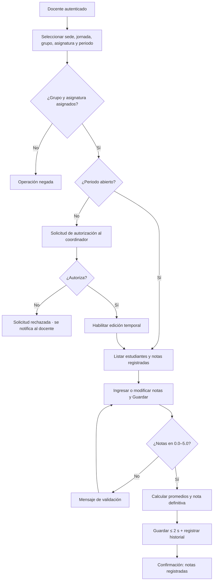

# Spec 0006: Registrar y modificar calificaciones

| Campo | Valor |
| --- | --- |
| ID | SPEC-0006 |
| Épica | EP-03 Gestión de calificaciones |
| Historias de usuario | HU-02 Registrar y modificar calificaciones (L, 36,83 h); HU-09 Calcular promedios y notas definitivas (M, 26,00 h); HU-11 Validar calificaciones (S, 13,08 h) |
| Caso de uso | CU.0002 Registrar / Modificar Calificaciones |
| Proceso | BPMN 1: Registro y modificación de calificaciones [A4] |
| Actores | Docente (principal); coordinador y administrador (supervisión y autorización) |
| Prioridad | HU-02: Alta [A3] · CU.0002: MUY IMPORTANTE / URGENTE [A2] |
| Componente | Gestión de calificaciones (EP-03); Trazabilidad (EP-06) |
| ADR relacionados | [ADR-0003](../02-adrs/0003-base-de-datos-postgresql-centralizada.md), [ADR-0006](../02-adrs/0006-backend-modular-alineado-a-epicas.md), [ADR-0010](../02-adrs/0010-historial-de-cambios-en-base-de-datos.md) |
| Mockup | [0006-registrar-y-modificar-calificaciones.html](../04-mockups/0006-registrar-y-modificar-calificaciones.html) |
| Estado | En revisión |

## 1. Resumen y objetivo

Permitir que el docente registre y actualice las calificaciones de sus estudiantes, organizadas por sede, jornada, grupo, asignatura y periodo académico. Al guardar, el sistema valida la escala, calcula automáticamente los promedios y la nota definitiva y deja trazabilidad del cambio [A2][A3][A4]. Es el proceso núcleo que reemplaza las hojas de cálculo de cada docente [A4].

## 2. Alcance

**Dentro**
- Selección del contexto académico autorizado del docente.
- Listado de estudiantes del grupo con sus notas existentes.
- Registro y modificación de notas, con confirmación al cambiar un valor ya guardado.
- Validación de la escala 0.0–5.0 (HU-11).
- Cálculo automático de promedios y nota definitiva (HU-09).
- Bloqueo de edición en periodos cerrados y flujo de autorización.
- Registro en el historial de cada creación o modificación.

**Fuera**
- Consulta de solo lectura ([Spec 0007](0007-consultar-calificaciones.md)).
- Consulta del historial ([Spec 0009](0009-trazabilidad-de-cambios.md)).
- Configuración de periodos y asignaciones ([Spec 0004](0004-gestionar-estructura-academica.md), [Spec 0005](0005-configurar-periodos-academicos.md)).

## 3. Requisitos

### 3.1. Requisitos funcionales

| ID | Requisito | Fuente |
| --- | --- | --- |
| RF-0006-01 | El sistema debe mostrar al docente solo las sedes, jornadas, grupos, asignaturas y periodos académicos que tiene autorizados. | [A2] CU.0002 paso 2; [A3] HU-02 CA-1 |
| RF-0006-02 | El docente debe seleccionar sede, jornada, grupo, asignatura y periodo. | [A2] CU.0002 paso 3 |
| RF-0006-03 | El sistema debe verificar que el grupo y la asignatura estén asignados al docente; si no lo están, debe negar la operación. | [A2] CU.0002 error 3; [A4] BPMN 1 paso 2 |
| RF-0006-04 | El sistema debe validar si el periodo académico está abierto. | [A4] BPMN 1 paso 3 |
| RF-0006-05 | El sistema debe listar los estudiantes del grupo con las notas ya registradas, si existen. | [A2] CU.0002 paso 4; [A4] BPMN 1 paso 4 |
| RF-0006-06 | El docente debe poder ingresar o modificar la calificación de cada estudiante y dar clic en «Guardar». | [A2] CU.0002 pasos 5–6 |
| RF-0006-07 | Al modificar una nota ya guardada en un periodo abierto, el sistema debe mostrar el valor anterior y solicitar confirmación del cambio. | [A2] CU.0002 alt. 1–3 |
| RF-0006-08 | Al guardar, el sistema debe validar que cada nota esté en la escala 0.0–5.0. | [A2] CU.0002 paso 7; [A3] HU-02 CA-2; HU-11 |
| RF-0006-09 | Al guardar, el sistema debe calcular automáticamente los promedios y la nota definitiva. | [A2] CU.0002 paso 7; [A3] HU-02 CA-3; HU-09 |
| RF-0006-10 | El sistema debe guardar la calificación de forma centralizada. | [A2] CU.0002 postcondición |
| RF-0006-11 | El sistema debe registrar en el historial el usuario responsable, la fecha, el valor anterior y el valor nuevo de cada creación o modificación. | [A2] CU.0002; [A3] HU-02 CA-6; [A4] BPMN 1 paso 8 |
| RF-0006-12 | El sistema debe confirmar al docente que las notas quedaron registradas. | [A4] BPMN 1 paso 8 |
| RF-0006-13 | Si el periodo está cerrado, el sistema debe bloquear la edición e indicar que requiere autorización. | [A2] CU.0002 error 2 |
| RF-0006-14 | Si el periodo está cerrado, el sistema debe generar una solicitud de autorización que revisa el coordinador académico. | [A4] BPMN 1 paso 3 |
| RF-0006-15 | Si el coordinador aprueba, el sistema debe habilitar la edición de forma temporal; si la rechaza, el proceso termina y se notifica al docente. | [A4] BPMN 1 paso 3 |

### 3.2. Reglas de negocio

| ID | Regla | Fuente |
| --- | --- | --- |
| RN-0006-01 | El docente solo registra notas de los grupos y asignaturas que tiene asignados. | [A2]; [A4] |
| RN-0006-02 | La nota debe estar dentro de la escala institucional **0.0 a 5.0**. | [A2]; [A3]; [A4] |
| RN-0006-03 | No se modifican notas de un periodo cerrado sin autorización. Quién autoriza: ver P-0006-01. | [A2]; [A3]; [A4] |
| RN-0006-04 | Toda creación o cambio queda en el historial de calificaciones. | [A2] |
| RN-0006-05 | Estructura de notas mostrada en la vista: **5 notas por asignatura, cada una con un peso del 20 %**, y una columna «Definitiva». | [VIS] (pendiente de confirmación, ver P-0006-02) |
| RN-0006-06 | Si la estructura de RN-0006-05 se confirma, la definitiva es `Σ (nota_i × 0,20)` para i = 1…5. | Derivado de [VIS]; pendiente de confirmación |

### 3.3. Requisitos no funcionales

| ID | Categoría | Requisito y métrica | Fuente |
| --- | --- | --- | --- |
| RNF-0006-01 | Rendimiento | El guardado de una calificación no debe superar **2 segundos**. | [A2] necesidades y CU.0002; [A3] HU-02 CA-4; [A4] |
| RNF-0006-02 | Integridad | Si falla el guardado, el sistema no confirma el registro y no altera la nota anterior. | [A2] CU.0002 error 4 |
| RNF-0006-03 | Disponibilidad | Acceso web desde un navegador. | [A2] |

## 4. Datos y contratos

| Entidad | Atributos mencionados | Fuente |
| --- | --- | --- |
| Calificación | Estudiante, asignatura, grupo, periodo, valor (0.0–5.0) | [A2] |
| Nota parcial | Nota 1…Nota 5 con peso del 20 % | [VIS] |
| Nota definitiva | Calculada por el sistema | [A2]; [VIS] |
| Historial de calificación | Usuario responsable, fecha, valor anterior, valor nuevo | [A2]; [A3] |
| Solicitud de autorización | Docente, periodo cerrado, decisión (aprobada/rechazada) | [A4] BPMN 1 (atributos detallados: **No documentado**) |

- Formato visual de las notas: un decimal con coma, por ejemplo «4,5» [VIS]. La regla de redondeo: **No documentado**.
- Contratos de API: **No documentado**.

## 5. Flujos y estados



Secuencia alternativa (corrección en periodo abierto): seleccionar estudiante → modificar valor → el sistema muestra el valor anterior y pide confirmación → el docente confirma → se actualiza, se recalcula y se registra en el historial [A2].

Estados de la pantalla: selección de contexto · cargando estudiantes · edición · error de validación · confirmación de cambio · guardando · guardado con éxito · error de guardado · periodo cerrado (bloqueado) · operación negada.

## 6. Casos borde y errores

| Caso | Comportamiento esperado | Fuente |
| --- | --- | --- |
| Nota fuera de 0.0–5.0 (por ejemplo 5,1 o −0,5) | No se guarda; mensaje de validación. | [A2] error 1 |
| Periodo cerrado | Edición bloqueada; indica que requiere autorización. | [A2] error 2 |
| Grupo o asignatura no asignados | Operación negada. | [A2] error 3 |
| Fallo del guardado | No se confirma el registro; mensaje de error; la nota anterior no cambia. | [A2] error 4 |
| Valores límite 0.0 y 5.0 | Se aceptan (la escala es «de 0.0 a 5.0»). | [A2] |
| Nota vacía en alguna de las 5 columnas | **No documentado** (efecto sobre la definitiva). | — |
| Más de un decimal | **No documentado**. | — |

## 7. Criterios de aceptación

```gherkin
Escenario: Docente solo ve su contexto autorizado
  Dado un docente autenticado con grupos y asignaturas asignados
  Cuando abre "Registrar calificaciones"
  Entonces solo se le ofrecen las sedes, jornadas, grupos, asignaturas y periodos que tiene autorizados

Escenario: Registro válido
  Dado un docente con el grupo "10 - 1" y la asignatura "Matemáticas" asignados en un periodo abierto
  Cuando ingresa una nota de 4,5 para un estudiante y da clic en "Guardar"
  Entonces el sistema guarda la nota en un máximo de 2 segundos
  Y calcula automáticamente los promedios y la nota definitiva
  Y registra en el historial el usuario, la fecha, el valor anterior y el valor nuevo
  Y confirma que las notas quedaron registradas

Escenario: Nota fuera de escala
  Dado un docente editando calificaciones en un periodo abierto
  Cuando ingresa una nota de 5,1 y da clic en "Guardar"
  Entonces el sistema no guarda
  Y muestra un mensaje de validación

Escenario: Modificar una nota guardada
  Dado un estudiante con una nota guardada de 3,0 en un periodo abierto
  Cuando el docente la cambia a 3,5
  Entonces el sistema muestra el valor anterior 3,0 y solicita confirmación
  Y, al confirmar, actualiza la nota, recalcula promedios y definitiva y registra el cambio en el historial

Escenario: Periodo cerrado
  Dado un periodo académico cerrado
  Cuando el docente intenta modificar una nota
  Entonces el sistema bloquea la edición e indica que requiere autorización

Escenario: Grupo no asignado
  Dado un docente sin asignación en el grupo "10 - 2"
  Cuando intenta calificar ese grupo
  Entonces el sistema niega la operación

Escenario: Fallo del guardado
  Dado un error al guardar
  Cuando el docente da clic en "Guardar"
  Entonces el sistema no confirma el registro, muestra un error y conserva la nota anterior
```

Criterios pendientes: fórmula definitiva confirmada (P-0006-02) y flujo de autorización en pantalla (P-0006-03).

## 8. Riesgos y pendientes

| ID | Tipo | Descripción |
| --- | --- | --- |
| P-0006-01 | Inconsistencia de fuentes | Quién autoriza cambios en periodo cerrado: «coordinador o administrador» [A2][A3] frente a solo «coordinador académico» [A4 BPMN 1]. |
| P-0006-02 | Pendiente de confirmación | Número de notas (5) y pesos (20 % cada una) solo aparecen en [VIS]; no se indica si son fijos o configurables por asignatura. |
| P-0006-03 | No documentado | Pantallas de la solicitud de autorización (docente) y de su revisión (coordinador); duración de la «edición temporal». |
| P-0006-04 | Información insuficiente | Qué significa «promedios» además de la definitiva (por ejemplo, el «Promedio del periodo» de [VIS]). |
| P-0006-05 | Inconsistencia de fuentes | La vista [VIS] solo muestra los selectores Periodo, Asignatura y Grupo; CU.0002 exige además Sede y Jornada. |
| P-0006-06 | No documentado | Canal de la notificación de rechazo al docente. |
| P-0006-07 | No documentado | Regla de redondeo de la definitiva. |
