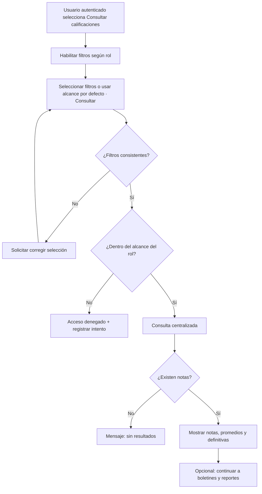

# Spec 0007: Consultar calificaciones

| Campo | Valor |
| --- | --- |
| ID | SPEC-0007 |
| Épica | EP-04 Consulta de calificaciones |
| Historias de usuario | HU-03 Consultar calificaciones (M, 26,00 h); HU-12 Consultar promedios y definitivas (S, 13,08 h); HU-13 Filtrar resultados académicos (S, 13,08 h) |
| Caso de uso | CU.0003 Consultar Calificaciones |
| Proceso | BPMN 2: Consulta de calificaciones [A4] |
| Actores | Estudiante, acudiente, docente, coordinador y administrador |
| Prioridad | HU-03: Alta [A3] · CU.0003: MUY IMPORTANTE / ALTA [A2] |
| Componente | Consulta de calificaciones (EP-04) |
| ADR relacionados | [ADR-0003](../02-adrs/0003-base-de-datos-postgresql-centralizada.md), [ADR-0005](../02-adrs/0005-autenticacion-jwt-y-autorizacion-por-roles.md), [ADR-0006](../02-adrs/0006-backend-modular-alineado-a-epicas.md) |
| Mockup | [0007-consultar-calificaciones.html](../04-mockups/0007-consultar-calificaciones.html) |
| Estado | En revisión |

## 1. Resumen y objetivo

Permitir consultar de forma rápida y centralizada las calificaciones, promedios y notas definitivas, con filtros por sede, jornada, grupo, asignatura, periodo y estudiante, según el rol del usuario autenticado y sin posibilidad de modificar los datos [A2][A3][A4].

## 2. Alcance

**Dentro**
- Filtros habilitados según el rol.
- Alcance por defecto cuando no se seleccionan filtros.
- Validación de consistencia de los filtros.
- Visualización de notas, promedios y definitivas organizados por asignatura y periodo.
- Mensaje informativo cuando no hay resultados.
- Acceso desde el resultado a la generación de boletines y reportes (usuarios autorizados).

**Fuera**
- Modificación de notas ([Spec 0006](0006-registrar-y-modificar-calificaciones.md)).
- Generación de boletines y reportes ([Spec 0008](0008-generar-boletines-y-reportes.md)).

## 3. Requisitos

### 3.1. Requisitos funcionales

| ID | Requisito | Fuente |
| --- | --- | --- |
| RF-0007-01 | El sistema debe ofrecer la opción «Consultar calificaciones» en el menú. | [A2] CU.0003 paso 1 |
| RF-0007-02 | El sistema debe habilitar los filtros permitidos según el rol (sede, jornada, grupo, asignatura, periodo o estudiante). | [A2] CU.0003 paso 2; [A4] BPMN 2 paso 2 |
| RF-0007-03 | Si el usuario no selecciona filtros, el sistema debe aplicar el alcance por defecto de su rol. | [A2] CU.0003 alt. 1 |
| RF-0007-04 | El sistema debe validar la consistencia de los filtros (que el grupo pertenezca a la sede y jornada indicadas) y, si son inconsistentes, solicitar corregir la selección. | [A2] CU.0003 error 2; [A4] BPMN 2 paso 4 |
| RF-0007-05 | El sistema debe mostrar las notas, promedios y definitivas organizados por asignatura y periodo. | [A2] CU.0003 paso 6; [A3] HU-12 |
| RF-0007-06 | Si no hay notas para el filtro, el sistema debe mostrar un mensaje de sin resultados sin generar error. | [A2] CU.0003 alt. 2; [A3] HU-03 CA-6 |
| RF-0007-07 | El coordinador y el administrador deben poder ampliar el filtro a otra sede, jornada o grupo y repetir la consulta. | [A2] CU.0003 alt. 3 |
| RF-0007-08 | Desde el resultado, el usuario autorizado debe poder continuar a la generación de boletines y reportes. | [A2] CU.0003 alt. 4; [A4] BPMN 2 paso 8 |
| RF-0007-09 | Si el usuario intenta consultar información fuera de su rol, el sistema debe denegar el acceso y registrar el intento. | [A2] CU.0003 error 1; [A4] BPMN 2 paso 5 |

### 3.2. Reglas de negocio

| ID | Regla | Fuente |
| --- | --- | --- |
| RN-0007-01 | El estudiante solo consulta sus propias notas. | [A2]; [A3] HU-03 CA-2 |
| RN-0007-02 | El acudiente solo consulta las notas de los estudiantes a su cargo. | [A2]; [A3] HU-03 CA-3 |
| RN-0007-03 | El docente consulta las notas de sus grupos y asignaturas asignados. | [A2]; [A3] HU-03 CA-4 |
| RN-0007-04 | El coordinador y el administrador consultan por sede, jornada, grupo, asignatura, periodo y estudiante. | [A2]; [A3] HU-03 CA-5; [A4] |
| RN-0007-05 | La consulta es de solo lectura: no modifica calificaciones. | [A2]; [A3] HU-03 CA-7; [A4] |
| RN-0007-06 | Si el estudiante o acudiente no tiene una asociación válida, no se muestran calificaciones. | [A2] CU.0003 error 3 |

### 3.3. Requisitos no funcionales

| ID | Categoría | Requisito y métrica | Fuente |
| --- | --- | --- | --- |
| RNF-0007-01 | Seguridad | Acceso web con usuario y contraseña; alcance restringido por rol. | [A2] |
| RNF-0007-02 | Seguridad | Los intentos de acceso fuera del rol se registran en el log de seguridad. | [A4] BPMN 2 |
| RNF-0007-03 | Rendimiento | La consulta debe ser «rápida». Métrica cuantitativa: **No documentado**. | [A2] |
| RNF-0007-04 | Disponibilidad | Los errores técnicos muestran un mensaje genérico y se registran. | [A2] CU.0003 error 4 |

## 4. Datos y contratos

Vista del estudiante [VIS] — columnas: Asignatura · Grupo · Nota 1 (20 %) … Nota 5 (20 %) · Definitiva; selector de Periodo; indicador «Promedio del periodo».

| Dato | Fuente |
| --- | --- |
| Calificaciones, promedios y notas definitivas | [A2]; [A4] |
| Filtros: sede, jornada, grupo, asignatura, periodo, estudiante | [A2] |

Contratos de API: **No documentado**.

## 5. Flujos y estados



Estados de la pantalla: filtros · cargando · con resultados · sin resultados · filtros inconsistentes · acceso denegado · error técnico.

## 6. Casos borde y errores

| Caso | Comportamiento esperado | Fuente |
| --- | --- | --- |
| Consulta fuera del rol | Acceso denegado y registro del intento. | [A2] error 1 |
| Grupo que no pertenece a la sede o jornada | Se solicita corregir la selección. | [A2] error 2 |
| Estudiante o acudiente sin asociación válida | No se muestran calificaciones. | [A2] error 3 |
| Error técnico | Mensaje genérico y registro del incidente. | [A2] error 4 |
| Sin notas para el filtro | Mensaje informativo, sin error. | [A2] alt. 2 |

## 7. Criterios de aceptación

```gherkin
Escenario: Estudiante consulta sus notas
  Dado un estudiante autenticado
  Cuando abre "Consultar calificaciones" y selecciona el periodo "2026 - 2"
  Entonces ve únicamente sus calificaciones, organizadas por asignatura, con la nota definitiva de cada una

Escenario: Alcance por defecto
  Dado un estudiante autenticado
  Cuando consulta sin seleccionar filtros
  Entonces el sistema aplica el alcance de su rol y muestra solo sus propias notas

Escenario: Acudiente
  Dado un acudiente asociado a un estudiante
  Cuando consulta calificaciones
  Entonces solo ve las calificaciones de los estudiantes a su cargo

Escenario: Docente
  Dado un docente autenticado
  Cuando consulta calificaciones
  Entonces solo ve las de sus grupos y asignaturas asignados

Escenario: Coordinador filtra por sede y jornada
  Dado un coordinador autenticado
  Cuando filtra por sede, jornada, grupo, asignatura y periodo
  Entonces ve las calificaciones que cumplen el filtro
  Y puede ampliar el filtro a otra sede, jornada o grupo y repetir la consulta

Escenario: Sin resultados
  Dado un filtro sin calificaciones registradas
  Cuando el usuario consulta
  Entonces el sistema muestra un mensaje de sin resultados y no genera error

Escenario: Filtros inconsistentes
  Dado un grupo que no pertenece a la sede o jornada seleccionadas
  Cuando el usuario consulta
  Entonces el sistema solicita corregir la selección

Escenario: Solo lectura
  Dado el resultado de una consulta
  Cuando el usuario lo visualiza
  Entonces no existe ninguna opción para modificar las calificaciones

Escenario: Acceso fuera del rol
  Dado un estudiante autenticado
  Cuando intenta consultar las notas de otro estudiante
  Entonces el sistema deniega el acceso y registra el intento
```

## 8. Riesgos y pendientes

| ID | Tipo | Descripción |
| --- | --- | --- |
| P-0007-01 | No documentado | Métrica de rendimiento de la consulta. |
| P-0007-02 | Información insuficiente | Cómo se calcula el «Promedio del periodo» de [VIS] (promedio simple de definitivas u otra fórmula). |
| P-0007-03 | No documentado | Diseño de la vista de resultados para docente, coordinador y administrador; [VIS] solo muestra la del estudiante. |
| P-0007-04 | No documentado | Cómo elige el acudiente entre varios estudiantes a su cargo. |
| P-0007-05 | Pendiente de confirmación | Qué roles pueden continuar a boletines y reportes («usuario autorizado»). |
